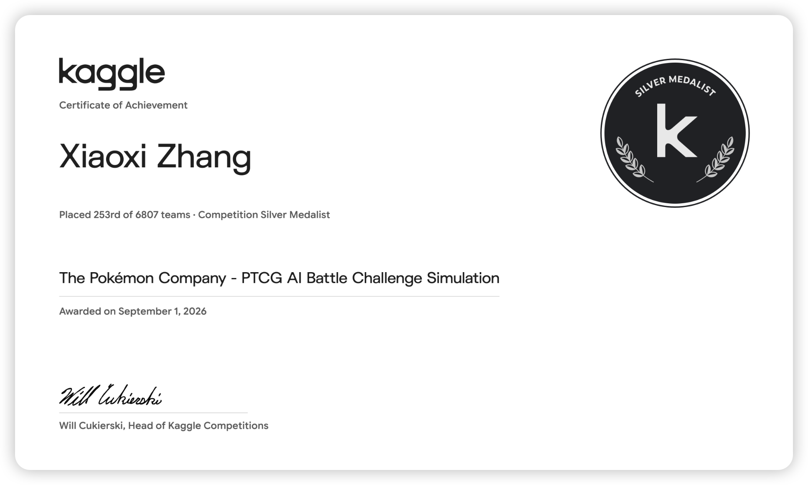

<h1 align="center">Xiaoxi Zhang</h1>

  麻醉医师 · 关注临床 AI 工具与 Agent 工作流 
  Anesthesiologist working on clinical AI tools and agent workflows

  
  
  

---

### 关于 · About

我是一名麻醉医师。业余时间主要做两件事：为麻醉与围术期场景搭建 AI 辅助工具，以及为 Codex / Claude Code 编写 Agent Skill 和工作流。

I'm an anesthesiologist. Outside the OR I mostly work on two things: AI-assisted tools for anesthesia and perioperative care, and agent skills / workflows for Codex and Claude Code.

### 项目 · Selected Projects

**医疗 AI 工具 · Clinical AI tools**

| Project | 简介 · Description |
| --- | --- |
| [**AnesGuardian**](https://github.com/zhangxiaoxi2025/AnesGuardian) | 麻醉守护神：面向麻醉医生的围术期决策支持系统，包括多智能体术前风险评估、药物相互作用分析和病历图像识别。 Perioperative decision-support system with multi-agent pre-op risk assessment, drug-interaction checks and medical-record image extraction. `TypeScript` `React` `Gemini` |
| [**AnesBGA**](https://github.com/zhangxiaoxi2025/AnesBGA) | 麻醉科血气分析助手：拍照识别血气报告，生成围术期分析建议；无需登录，不存储数据。 Blood-gas analysis assistant: OCR of a photographed report plus AI-generated interpretation; no login, no data stored. `Python` `FastAPI` `React` |

**Agent 与 Skill 工作流 · Agent & skill workflows**

| Project | 简介 · Description |
| --- | --- |
| [**translate-literature-skill**](https://github.com/zhangxiaoxi2025/translate-literature-skill) | Codex Skill：医学与科研文献的忠实全文翻译，四种模式，支持批量处理与断点续跑。 Codex skill for faithful full-text translation of medical literature; four modes, batch processing, resumable runs. |
| [**skill-router**](https://github.com/zhangxiaoxi2025/skill-router) | 在已安装的多个 Skill 中为任务选择最合适的一个；没有合适的 Skill 时直接说明。 Routes each task to the best installed skill, and says so plainly when no suitable skill exists. |

其他 · Other

- [**ollama-turboquant-tqkv**](https://github.com/zhangxiaoxi2025/ollama-turboquant-tqkv) — 基于 TurboQuant 的 KV cache 压缩合成基准测试（Rust）；尚未集成到 Ollama / llama.cpp。 Synthetic benchmarks of TurboQuant-based KV-cache compression in Rust; not yet integrated into Ollama / llama.cpp.
- [**xcnotes**](https://github.com/zhangxiaoxi2025/xcnotes) — 智能错题本：拍照上传，Gemini 解析题目与知识点。 AI-assisted error notebook: upload photos of questions, parsed with Gemini.

> 以上均为个人开源项目，用于研究与学习，不用于直接的临床决策。 
> These are personal open-source projects for research and learning, not for direct clinical decision-making.

### 荣誉 · Achievements

**Kaggle Competition Silver Medal** — *The Pokémon Company - PTCG AI Battle Challenge Simulation* 
第 253 名 / 6807 支队伍 · Placed 253rd of 6,807 teams · 2026-09-01

证书 · Certificate

 

### 技术栈 · Tech

  
  
  
  
  
  

### 联系 · Contact

欢迎就麻醉、围术期 AI 与 Agent 工作流交流。 
Happy to talk about anesthesia, perioperative AI and agent workflows — [zhangxiaoxi7097@gmail.com](mailto:zhangxiaoxi7097@gmail.com) · [LinkedIn](https://www.linkedin.com/in/xiaoxi-zhang-732306416/)
